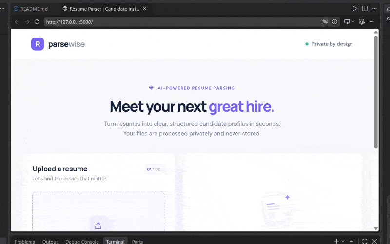
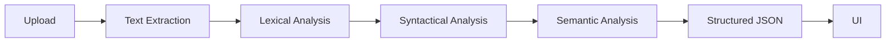

# AI Resume Parser

An NLP-powered Flask application that turns PDF, DOCX, and TXT resumes into structured candidate profiles.

[](https://github.com/YOUR_USERNAME/YOUR_REPO/actions/workflows/ci.yml)
[](https://github.com/YOUR_USERNAME/YOUR_REPO)
[](https://www.python.org/)
[](LICENSE)

## Demo



**Live Demo:** [Add your deployed app URL here](https://YOUR_LIVE_DEMO_URL)

Record a demo GIF yourself and save it as `docs/demo.gif`; see [docs/README.md](docs/README.md).

## Overview

Resume Parser is a local-first parser that extracts contact details and relevant candidate information from common resume formats. Uploads are read in memory and are not written to permanent storage. spaCy's `en_core_web_sm` model is used when available for person-name recognition; deterministic regex and dictionary-based fallbacks keep the application useful without a model download or paid API.

### Features

- PDF, DOCX, and UTF-8 TXT text extraction.
- Candidate name, email, phone, LinkedIn/GitHub, normalized skills, education, experience, projects, and certifications.
- Compiler-inspired lexical, syntactical, and semantic parsing stages.
- Drag-and-drop upload, loading feedback, candidate cards, raw JSON display, and accessible errors.
- 5 MB upload limit, filename sanitization, extension allowlist, and in-memory processing.
- Optional LLM integration is a disabled stub; no credentials or external paid APIs are needed.

## Architecture



See [docs/architecture.md](docs/architecture.md) for the pipeline notes.

## Compiler-design mapping

| Compiler stage | Resume-parser implementation |
|---|---|
| Lexical analysis | `clean_text`, `tokenize_words`, and `tokenize_lines` normalize extraction noise and produce line/word tokens. |
| Syntactical analysis | `detect_sections` groups lines under recognized headings; section aliases provide grammar-like patterns. |
| Semantic analysis | `analyze_candidate`, `extract_email`, `extract_phone`, and `normalize_skills` validate and normalize fields; supporting helpers normalize degrees and dates and estimate experience duration. |

## Folder structure

```text
.
├── app.py
├── parser/
│   ├── extractor.py
│   ├── lexer.py
│   ├── semantic.py
│   └── syntax.py
├── templates/index.html
├── static/
│   ├── css/style.css
│   └── js/app.js
├── tests/
├── samples/
│   └── expected_output/
├── scripts/generate_samples.py
├── docs/
├── .github/workflows/ci.yml
├── Dockerfile
└── docker-compose.yml
```

## Tech stack

- **Backend:** Python 3.11, Flask, pdfminer.six, python-docx.
- **NLP:** spaCy `en_core_web_sm` (optional at runtime; regex fallback).
- **Frontend:** Vanilla JavaScript, HTML, and CSS.
- **Quality and delivery:** pytest, pytest-cov, GitHub Actions, Docker, Gunicorn.

## Local setup

Use Python 3.11. From the repository root:

```powershell
py -3.11 -m venv .venv
.\.venv\Scripts\Activate.ps1
python -m pip install --upgrade pip
python -m pip install -r requirements.txt
python -m spacy download en_core_web_sm
python scripts/generate_samples.py
python app.py
```

If PowerShell prevents activation, allow scripts for the current process with `Set-ExecutionPolicy -Scope Process -ExecutionPolicy Bypass`, then activate again. Browse to `http://127.0.0.1:5000`.

The TXT sample is checked in directly. `sample_resume_1.pdf` and `sample_resume_2.docx` are generated locally by `python scripts/generate_samples.py` and are intentionally ignored by Git.

## Docker setup

Docker builds install the pinned Python dependencies and download the spaCy model:

```bash
docker compose up --build
```

Open `http://localhost:5000`. Stop the container with `Ctrl+C`; run `docker compose down` to remove the container.

## Usage

1. Choose or drag a PDF, DOCX, or TXT resume into the upload area (up to 5 MB).
2. Select **Parse resume** and wait for the candidate snapshot.
3. Review the profile cards or open **View raw JSON**.


The screenshot image is a placeholder path; add your own screenshot if desired.

## API documentation

### `POST /api/parse`

Send a `multipart/form-data` request with a `file` field. Allowed extensions are `.pdf`, `.docx`, and `.txt`; maximum request file size is 5 MB. Files are not persisted.

Example:

```bash
curl -X POST http://127.0.0.1:5000/api/parse \
  -F "file=@samples/sample_resume_3.txt"
```

Successful response (`200`):

```json
{
  "success": true,
  "filename": "sample_resume_3.txt",
  "candidate": {
    "name": "Maya Chen",
    "email": "maya.chen@example.com",
    "phone": "+1 (415) 555-0132",
    "linkedin": "https://www.linkedin.com/in/maya-chen",
    "github": "https://github.com/mayachen",
    "skills": ["Docker", "Flask", "JavaScript", "Natural Language Processing", "Python", "SQL"],
    "education": [
      {
        "degree": "Bachelor of Science",
        "institution": "University of California, Berkeley",
        "dates": ["2020"]
      }
    ],
    "experience": [
      {
        "title": "Software Engineer",
        "organization": "Bright Labs",
        "dates": ["2021-01", "2026-10"]
      }
    ],
    "total_years_experience": 5,
    "projects": ["Candidate Insights Dashboard - Built an accessible hiring dashboard."],
    "certifications": ["AWS Certified Cloud Practitioner"]
  }
}
```

Candidate collections are empty when no corresponding section is detected. Education entries contain `degree`, `institution`, and normalized `dates`; experience entries contain a normalized `title`, best-effort `organization`, and normalized `dates`. Date normalization and duration are heuristic estimates, not authoritative employment verification.

| Status | Meaning |
|---|---|
| `400` | Missing/empty file or invalid filename. |
| `413` | Upload exceeds 5 MB. |
| `415` | Unsupported extension. |
| `422` | Supported file could not be read, or contains no readable text. |
| `500` | Unexpected parsing failure; details are logged server-side. |

## Testing

Install dependencies, generate the sample PDF/DOCX, then run:

```bash
pytest
```

Coverage is configured in `pytest.ini` and reports parser/app coverage in the terminal and `coverage.xml`. Sample tests assert the expected structured-output schema across all three formats.

## Deployment

Set the start command to `gunicorn --bind 0.0.0.0:$PORT app:app`. Ensure the platform uses Python 3.11 and installs `requirements.txt`; include `python -m spacy download en_core_web_sm` in the build step if you want spaCy name recognition. The regex fallback works if the model is omitted.

### Render

1. Push the project to a GitHub repository you control.
2. In Render, create **New → Web Service** and connect that repository.
3. Select Python runtime, set the build command to `pip install -r requirements.txt && python -m spacy download en_core_web_sm`, and use the Gunicorn start command above.
4. Deploy, verify the service URL, and set the README Live Demo link.

### Railway

1. Push the project to a GitHub repository you control.
2. In Railway, create a project from that GitHub repository.
3. Configure the build to install `requirements.txt` and download the model if desired; set the start command to `gunicorn --bind 0.0.0.0:$PORT app:app`.
4. Generate a public domain, verify the service, and add that URL to the README.

No deployment is performed by this project setup.

## Future improvements

- Add multilingual extraction and configurable section taxonomies.
- Add richer date interval parsing and overlap-aware experience totals.
- Add an opt-in, privacy-reviewed LLM adapter behind a feature flag.
- Add export formats, accessibility review, and more document fixtures.

## Resume-ready project bullets

- Built a modular Flask resume-parsing API that converts PDF, DOCX, and TXT documents into structured candidate profiles using spaCy and deterministic regex fallbacks.
- Applied compiler-design stages—lexical normalization, section-based syntactical analysis, and semantic field validation—to extract contacts, skills, education, and work history.
- Implemented privacy-conscious in-memory uploads, file validation, an interactive vanilla-JavaScript interface, and automated coverage-tested CI.

## Exact local commands

The commands below are for Windows PowerShell, from the project root:

```powershell
# 1. Create and activate a virtual environment
py -3.11 -m venv .venv
.\.venv\Scripts\Activate.ps1

# 2. Install dependencies
python -m pip install --upgrade pip
python -m pip install -r requirements.txt

# 3. Download the spaCy model
python -m spacy download en_core_web_sm

# 4. Generate sample files
python scripts/generate_samples.py

# 5. Run tests with coverage
pytest

# 6. Run the app locally
python app.py

# 7. Build and run with Docker
docker compose up --build
```

For Docker, run the final command in a separate terminal after setup, or stop the local server with `Ctrl+C`.

## License

MIT. See [LICENSE](LICENSE).
