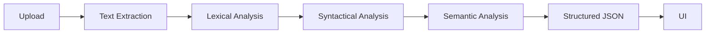

# Architecture

Uploads are size- and extension-checked and consumed from memory. The parser normalizes extracted text, identifies section blocks, and resolves candidate fields into a stable JSON shape. The browser renders the result and an optional raw JSON view.
